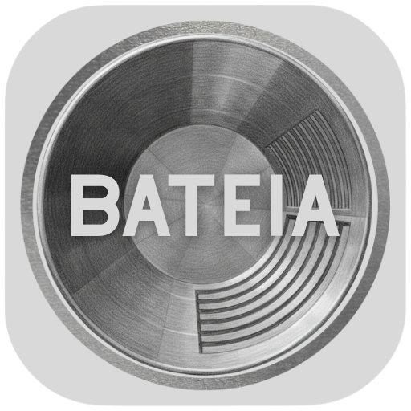
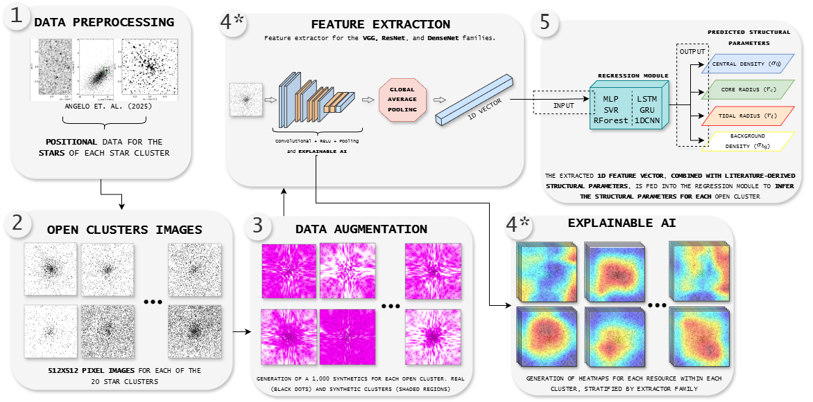
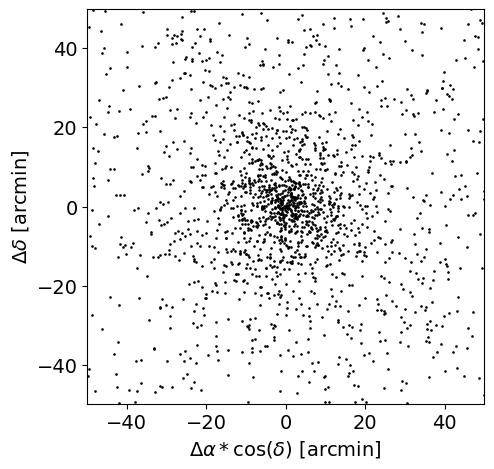
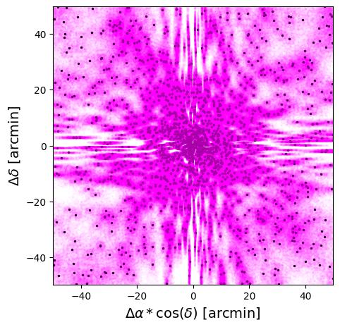
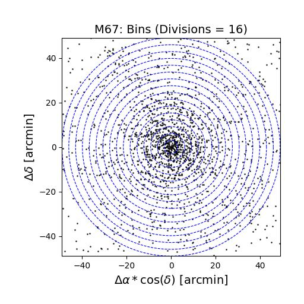
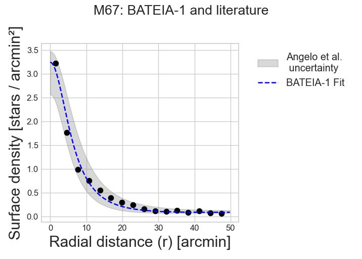
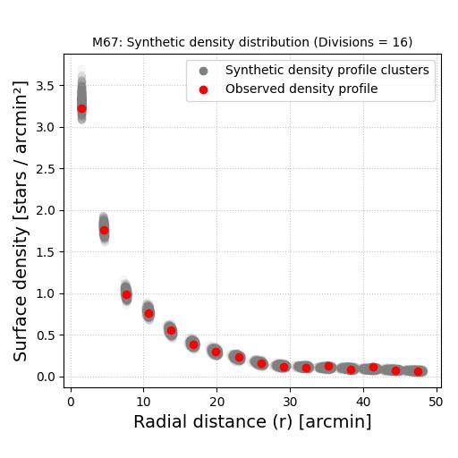
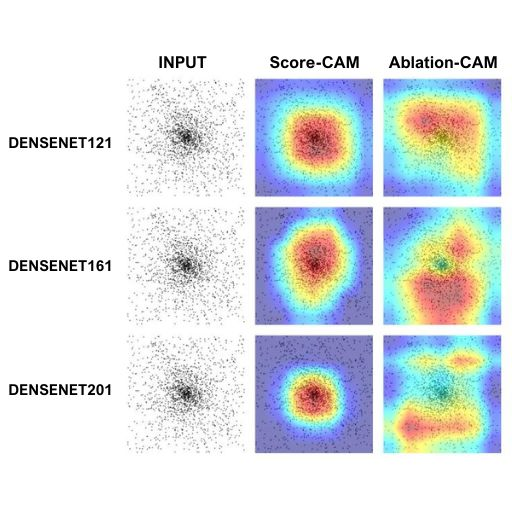
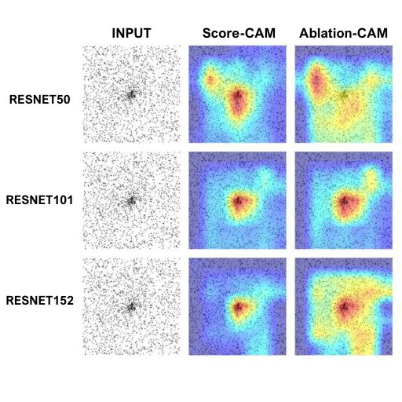
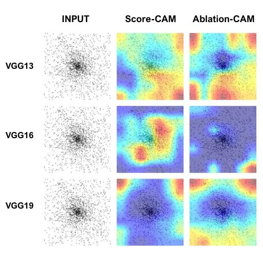

<p align="center"></p>

<p align="center"><a href="README.md">English</a> · <a href="readme/README.pt-BR.md">Português (Brasil)</a> · <a href="readme/README.es.md">Español</a></p>

# BATEIA-1

**Balanced ArTificial-intelligence Method for EstImating parameters of stAr clusters**

Estimate the structural parameters of open star clusters from stellar maps using synthetic data, pretrained visual feature extractors and regression.

<a id="overview"></a>
## Scientific overview

Open star clusters are natural laboratories for studying stellar evolution and Galactic structure. BATEIA-1 estimates their structural parameters by combining the analytical King profile with machine learning and deep learning applied to stellar sky maps derived from Gaia DR3 astrometric and photometric data. It targets central stellar density, core radius, tidal radius and background stellar density, providing a data-driven approach to automate cluster structure characterization.

The associated study uses nine pretrained deep neural networks for visual feature extraction, followed by Multilayer Perceptron (MLP) and Support Vector Regression (SVR) models. For M67, NGC 188 and NGC 6811, the article reports differences from literature values of **0.7–12.8% for tidal radius, 1.1–5.5% for core radius and 1.1–8.7% for central density**. Score-CAM and Ablation-CAM provide complementary diagnostics of the visual extractors. These results refer to the study's experiments; the method inherits the assumptions of its King-profile reference labels. See the [article](https://doi.org/10.1016/j.ascom.2026.101119) for the evaluation and scope.

**Keywords:** open star clusters; astrophysics; Galactic structure; Gaia DR3; structural parameters; King profile; King function; stellar density; machine learning; deep learning; feature extraction; regression; explainable artificial intelligence (XAI); Score-CAM; Ablation-CAM.

[Overview](#overview) · [Pipeline](#pipeline) · [Examples](#examples) · [Quick start](#start) · [Documentation](#docs) · [Citation](#citation)

<a id="pipeline"></a>
## Pipeline

BATEIA-1 combines King profiles with machine learning to estimate **central density (`f0`), core radius (`Rc`), tidal radius (`Rt`) and background density (`fbg`)**.

<p align="center"></p>

From prepared stellar coordinates to cluster images, synthetic augmentation, visual features and parameter regression. Explainable AI provides a parallel diagnostic of the extractors.

**Extractors:** VGG13/16/19, ResNet50/101/152 and DenseNet121/161/201.  
**Regressors:** MLP, SVR, Random Forest, LSTM, GRU and 1D-CNN; GAP and no-GAP feature modes.

<a id="examples"></a>
## M67: data, results and explainability

### Stellar maps and radial binning

<table>
<tr><th align="center">Stellar map</th><th align="center">Synthetic overview</th><th align="center">Spatial binning: 16 annuli</th></tr>
<tr><td align="center"><a href="readme/assets/M67_stars.jpg"></a></td><td align="center"><a href="readme/assets/M67_synthetics_overview.jpg"></a></td><td align="center"><a href="readme/assets/M67_spatial_dist_best.jpg"></a></td></tr>
<tr><td valign="top">Prepared stellar positions for M67, centred on the cluster. The axes show angular offsets in arcminutes; the central concentration and surrounding field define the spatial distribution used to construct the sky-map input.</td><td valign="top">Overlay of synthetic spatial distributions (magenta) and the real stellar positions (black). This view shows the spatial variation introduced by data augmentation; it is not an additional observation or a feature-attribution heatmap.</td><td valign="top">The same stellar field divided into 16 concentric radial annuli (blue dashed boundaries). Counts within each annular area are used to construct the radial surface-density profile; the circles represent bin boundaries, not separate fitted cluster radii.</td></tr>
</table>

### Radial density profiles

<table>
<tr><th align="center">King profile: BATEIA-1 and literature</th><th align="center">Observed and synthetic density profiles</th></tr>
<tr><td align="center"><a href="readme/assets/king_uncertainty_M67_AM.jpg"></a></td><td align="center"><a href="readme/assets/M67_real_and_synthetic_rdp.jpg"></a></td></tr>
<tr><td valign="top">M67 surface density as a function of radius: black data points, the BATEIA-1 King-profile curve (blue dashed) and the literature uncertainty band from Angelo et al. (grey). This is one cluster example; the band does not establish a calibrated predictive interval for arbitrary new clusters.</td><td valign="top">Observed radial densities (red) overlaid with synthetic-profile densities (grey), using 16 radial divisions. The spread visualizes how the synthetic sample varies around the observed profile at each radius; it is not a confidence interval on the regressor predictions.</td></tr>
</table>

### Explainable AI: extractor families

<table>
<tr><th align="center">DenseNet: Score-CAM and Ablation-CAM</th><th align="center">ResNet: Score-CAM and Ablation-CAM</th><th align="center">VGG: Score-CAM and Ablation-CAM</th></tr>
<tr><td align="center"><a href="readme/assets/heatmap_densenet_m67.jpg"></a></td><td align="center"><a href="readme/assets/heatmap_resnet_M67.jpg"></a></td><td align="center"><a href="readme/assets/heatmap_vgg_M67.jpg"></a></td></tr>
<tr><td valign="top">Input, Score-CAM and Ablation-CAM panels for DenseNet121, DenseNet161 and DenseNet201. The maps show where each extractor responds within M67, with different spatial patterns across network depths and visualization methods.</td><td valign="top">Input, Score-CAM and Ablation-CAM panels for ResNet50, ResNet101 and ResNet152. Compare the locations and spatial extent of the responses across residual-network depths and methods, using the same cluster as the visual reference.</td><td valign="top">Input, Score-CAM and Ablation-CAM panels for VGG13, VGG16 and VGG19. The maps illustrate responses that can extend into off-centre regions; the panels allow inspection of how these patterns differ from the DenseNet and ResNet families.</td></tr>
</table>

In each family panel, columns are the input, Score-CAM and Ablation-CAM; rows identify the extractor variant. Colours encode relative responses within each visualization. They are diagnostic maps of the visual extractors, not confidence intervals, physical causality or direct parameter-specific explanations of the downstream regressors; colours should not be treated as a common quantitative scale across panels.

The approach targets non-embedded open clusters described by single-component King profiles and inherits the assumptions of its reference labels. The article evaluates MLP and SVR; additional regressors are covered by the dissertation and source.

<a id="start"></a>
## Quick start

### 1. Create the environment

Install Conda/Miniconda, then open a terminal in the project root:

```sh
conda env create -f environment.yml
conda activate bateia
```

The environment requests Python 3.12 and adds the PyTorch nightly CUDA 12.8 index. Package versions are not locked; GPU use requires a compatible driver/build. Installation and platform compatibility have not been tested for this documentation.

### 2. Prepare the data

Place prepared coordinates and literature targets in `database/`, or set `BATEIA_ROOT` to your data directory before launching Python. Training also requires generated features and matching targets. See the [data format and setup guide](readme/USAGE.md#data).

The Google Drive setup route requires your own OAuth configuration and access to the configured folder. ImageNet extractor weights may download on first use. Data and trained BATEIA regressors must be supplied separately; no public Zenodo download URL has been configured in this documentation.

### 3. Open the interactive menu

```sh
python bateia_exec.py
```

1. **Setup and Data Download**: prepare literature parameters and cluster files, if using Drive.
2. **Verify Local Clusters**: confirm your prepared clusters are detected.
3. **Run Analysis and AI Pipeline**: process real data, generate/analyse synthetics and extract features before training.
4. **Run AI Training**: choose a model, matching GAP mode and cluster split. Use AM for unseen-cluster evaluation; BM uses all data.
5. **Generate Results and Paper Reports**: inspect predictions and reports.

Start with one cluster to inspect preprocessing. The documented manual training split requires at least 20 clusters. **Reset Workspace deletes generated data/models.** See the [complete usage guide](readme/USAGE.md) for dependencies, split options and output paths.

**Current interface:** terminal menu. A simplified notebook/Kaggle API and packaged installation workflow are not implemented.

<a id="docs"></a>
## Documentation

- [Analyse your own stellar cluster data](readme/CUSTOM_DATA.md)
- [Installation, data and usage](readme/USAGE.md)
- [Architecture](readme/ARCHITECTURE.md)
- [Models and optimization](readme/MODELS_GUIDE.md)
- [GPU parallelism](readme/GPU_PARALLELISM.md)
- [Dependencies](readme/DEPENDENCIES.md)

<a id="citation"></a>
## Citation

For the methodology and experimental results, cite:

Mendes, D. C.; Santiago Júnior, V. A.; Angelo, M. S. (2026). **BATEIA-1: An Approach for determining the structural parameters of open star clusters via machine and deep learning.** *Astronomy and Computing*, 56, 101119. [DOI](https://doi.org/10.1016/j.ascom.2026.101119).

### License

See [LICENSE](LICENSE) for the GNU General Public License v3 text distributed with this repository. Publication and third-party data licenses are separate.
