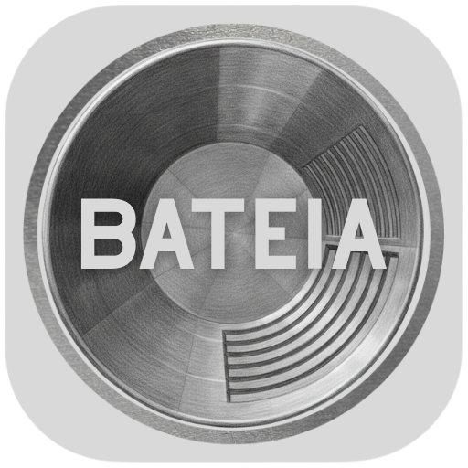
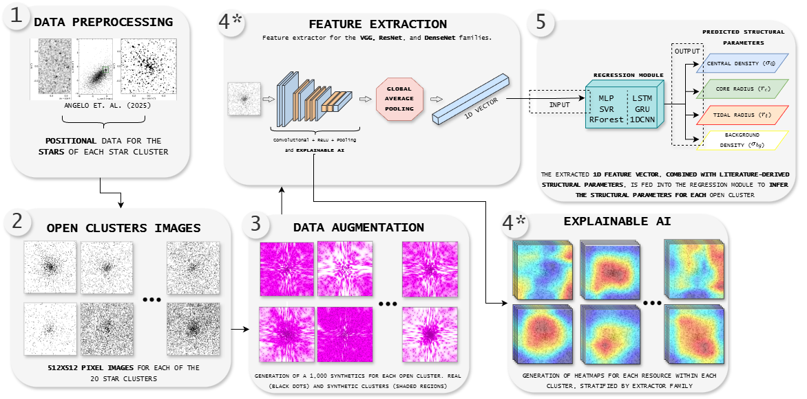
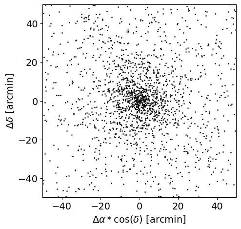
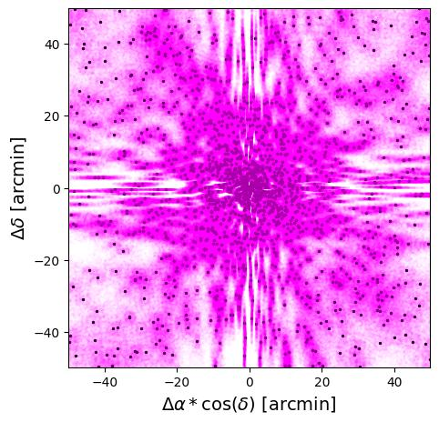
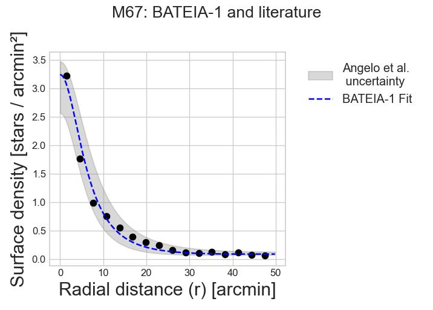
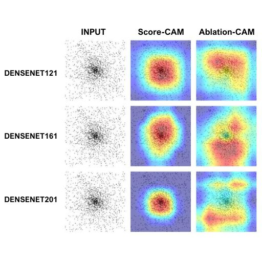

<p align="center"></p>

<p align="center"><a href="../README.md">English</a> · <a href="../readme/README.pt-BR.md">Português (Brasil)</a> · <a href="../readme/README.es.md">Español</a></p>

# BATEIA-1

**Balanced ArTificial-intelligence Method for EstImating parameters of stAr clusters**

Estime parámetros estructurales de cúmulos estelares abiertos a partir de mapas estelares, con datos sintéticos, extractores visuales preentrenados y regresión.

[Flujo](#pipeline) · [Ejemplos](#examples) · [Inicio rápido](#start) · [Documentación](#docs) · [Cita](#citation)

<a id="pipeline"></a>
## Pipeline

BATEIA-1 combina perfiles de King y aprendizaje automático para estimar **densidad central (`f0`), radio del núcleo (`Rc`), radio de marea (`Rt`) y densidad de fondo (`fbg`)**.

<p align="center"></p>

De las coordenadas estelares preparadas a imágenes, aumento de datos sintéticos, características visuales y regresión de parámetros. La IA Explicable proporciona un diagnóstico paralelo de los extractores.

**Extractores:** VGG13/16/19, ResNet50/101/152 y DenseNet121/161/201.  
**Regresores:** MLP, SVR, Random Forest, LSTM, GRU y 1D-CNN; características con GAP y sin GAP.

<a id="examples"></a>
## M67: datos, resultados y explicabilidad

<table>
<tr><th>Mapa estelar</th><th>Vista de sintéticos</th></tr>
<tr><td></td><td></td></tr>
</table>

Posiciones estelares de M67 (izquierda) y vista de los sintéticos (derecha). Los puntos negros y la superposición magenta muestran la distribución real y la vista de la muestra sintética, respectivamente; la superposición no es una imagen observacional.

<p align="center"></p>

Perfil de densidad radial de M67: ajuste BATEIA-1 (azul discontinuo), puntos de datos (negro) y banda de incertidumbre bibliográfica de Angelo et al. (gris). Ilustra un resultado, no una medida agregada de rendimiento.

<p align="center"></p>

Explicabilidad DenseNet para M67: mapas de entrada, Score-CAM y Ablation-CAM para DenseNet121, DenseNet161 y DenseNet201. Los colores muestran respuestas espaciales de los métodos de visualización; estos diagnósticos no establecen por sí solos causalidad física.

La metodología se dirige a cúmulos abiertos no embebidos descritos por perfiles de King de un componente y conserva las hipótesis de las etiquetas de referencia. El artículo evalúa MLP y SVR; la tesis y el código abarcan regresores adicionales.

<a id="start"></a>
## Inicio rápido

### 1. Cree el entorno

Instale Conda/Miniconda y abra una terminal en la raíz del proyecto:

```sh
conda env create -f environment.yml
conda activate bateia
```

El entorno solicita Python 3.12 y añade el índice PyTorch nightly con CUDA 12.8. Las versiones no están bloqueadas; GPU exige controlador/distribución compatibles. La instalación y compatibilidad de plataformas no se probaron para esta documentación.

### 2. Prepare los datos

Coloque coordenadas preparadas y etiquetas bibliográficas en `database/`, o defina `BATEIA_ROOT` como su carpeta de datos antes de iniciar Python. El entrenamiento también exige características generadas y etiquetas correspondientes. Consulte [formato de datos y configuración](USAGE.es.md#data).

La configuración mediante Google Drive exige su propio OAuth y acceso a la carpeta configurada. Los pesos ImageNet pueden descargarse durante el primer uso. Datos y regresores BATEIA entrenados deben proporcionarse por separado; no se ha configurado ninguna URL pública de descarga Zenodo en esta documentación.

### 3. Abra el menú interactivo

```sh
python bateia_exec.py
```

1. **Setup and Data Download**: prepare parámetros bibliográficos y archivos de cúmulos, si utiliza Drive.
2. **Verify Local Clusters**: compruebe la detección de cúmulos preparados.
3. **Run Analysis and AI Pipeline**: procese datos reales, genere/analice sintéticos y extraiga características antes de entrenar.
4. **Run AI Training**: elija modelo, modo GAP correspondiente y división por cúmulo. Use AM para evaluar casos no vistos; BM utiliza todos los datos.
5. **Generate Results and Paper Reports**: inspeccione predicciones e informes.

Empiece con un cúmulo para inspeccionar el preprocesamiento. La división manual documentada exige al menos 20 cúmulos. **Reset Workspace elimina datos/modelos generados.** Consulte la [guía completa](USAGE.es.md) para dependencias, divisiones y salidas.

**Interfaz actual:** menú de terminal. Una API simplificada para notebooks/Kaggle y la instalación como paquete aún no están implementadas.

<a id="docs"></a>
## Documentación

- [Instalación, datos y uso](USAGE.es.md)
- [Arquitectura](../readme/ARQUITETURA.md)
- [Modelos y optimización](../readme/MODELS_GUIDE.md)
- [Paralelismo en GPUs](../readme/PARALELISMO-GPUS.md)
- [Dependencias](../environment.yml)

<a id="citation"></a>
## Cita

Para la metodología y los resultados experimentales, cite:

Mendes, D. C.; Santiago Júnior, V. A.; Angelo, M. S. (2026). **BATEIA-1: An Approach for determining the structural parameters of open star clusters via machine and deep learning.** *Astronomy and Computing*, 56, 101119. [DOI](https://doi.org/10.1016/j.ascom.2026.101119).

### Licencia

Consulte [LICENSE](../LICENSE) para el texto de GNU General Public License v3 distribuido con este repositorio. Las publicaciones y los datos de terceros tienen licencias propias.
