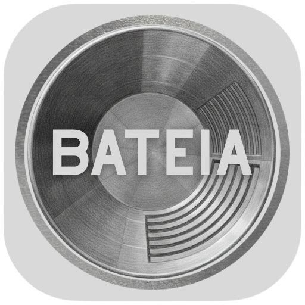
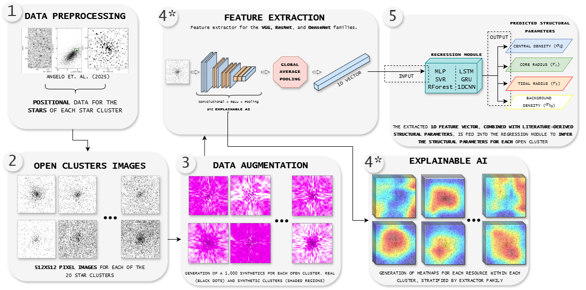
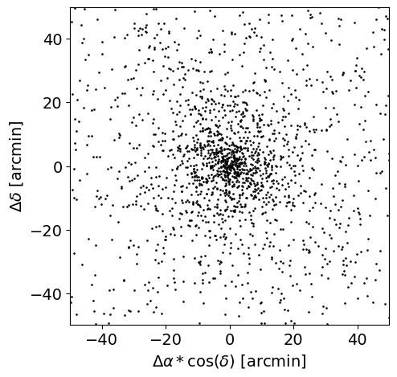
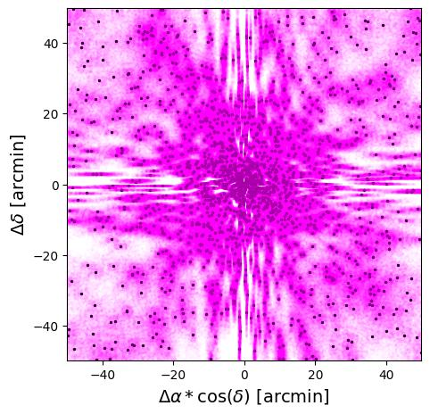
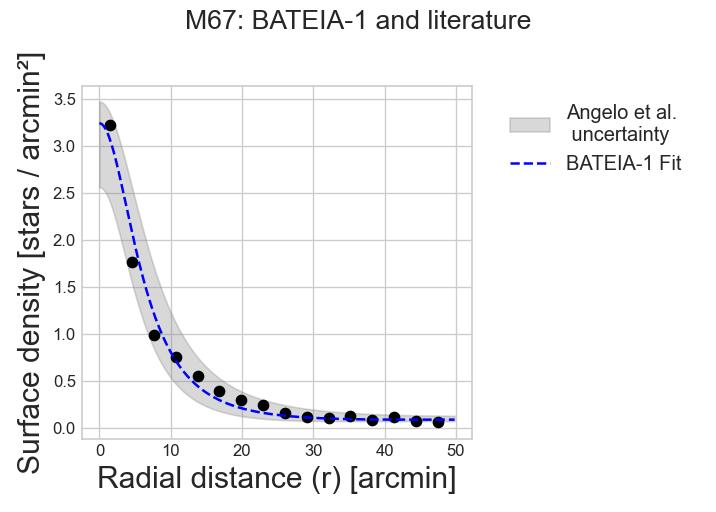
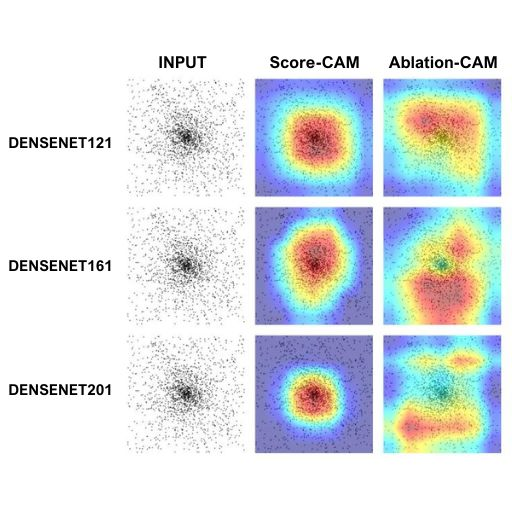

<p align="center"></p>

<p align="center"><a href="../README.md">English</a> · <a href="../readme/README.pt-BR.md">Português (Brasil)</a> · <a href="../readme/README.es.md">Español</a></p>

# BATEIA-1

**Balanced ArTificial-intelligence Method for EstImating parameters of stAr clusters**

Estime parâmetros estruturais de aglomerados estelares abertos a partir de mapas estelares, usando dados sintéticos, extratoras visuais pré-treinadas e regressão.

<a id="overview"></a>
## Resumo científico

Aglomerados estelares abertos são laboratórios naturais para estudar a evolução estelar e a estrutura da Galáxia. O BATEIA-1 estima seus parâmetros estruturais combinando o perfil analítico de King com aprendizado de máquina e aprendizado profundo aplicados a mapas estelares derivados de dados astrométricos e fotométricos do Gaia DR3. A abordagem estima densidade estelar central, raio do núcleo, raio de maré e densidade estelar de fundo, buscando automatizar a caracterização da estrutura dos aglomerados.

O estudo associado utiliza nove redes neurais profundas pré-treinadas para extração de características visuais, seguidas por modelos Multilayer Perceptron (MLP) e Support Vector Regression (SVR). Para M67, NGC 188 e NGC 6811, o artigo relata diferenças em relação à literatura de **0,7–12,8% no raio de maré, 1,1–5,5% no raio do núcleo e 1,1–8,7% na densidade central**. Score-CAM e Ablation-CAM oferecem diagnósticos complementares das extratoras visuais. Esses resultados correspondem aos experimentos do estudo; o método preserva as hipóteses dos rótulos de referência baseados no perfil de King. Consulte o [artigo](https://doi.org/10.1016/j.ascom.2026.101119) para a avaliação e o escopo.

**Palavras-chave:** aglomerados estelares abertos; astrofísica; estrutura galáctica; Gaia DR3; parâmetros estruturais; perfil de King; função de King; densidade estelar; aprendizado de máquina; aprendizado profundo; extração de características; regressão; inteligência artificial explicável (XAI); Score-CAM; Ablation-CAM.

[Resumo](#overview) · [Pipeline](#pipeline) · [Exemplos](#examples) · [Início rápido](#start) · [Documentação](#docs) · [Citação](#citation)

<a id="pipeline"></a>
## Pipeline

O BATEIA-1 combina perfis de King e aprendizado de máquina para estimar **densidade central (`f0`), raio do núcleo (`Rc`), raio de maré (`Rt`) e densidade de fundo (`fbg`)**.

<p align="center"></p>

Das coordenadas estelares preparadas às imagens, aumento de dados sintéticos, características visuais e regressão de parâmetros. A IA Explicável oferece um diagnóstico paralelo das extratoras.

**Extratoras:** VGG13/16/19, ResNet50/101/152 e DenseNet121/161/201.  
**Regressores:** MLP, SVR, Random Forest, LSTM, GRU e 1D-CNN; características com GAP e sem GAP.

<a id="examples"></a>
## M67: dados, resultados e explicabilidade

<table>
<tr><th>Mapa estelar</th><th>Visão dos sintéticos</th></tr>
<tr><td></td><td></td></tr>
</table>

Posições estelares de M67 (esquerda) e visão dos sintéticos (direita). Os pontos pretos e a sobreposição magenta mostram, respectivamente, a distribuição real e a visão da amostra sintética; a sobreposição não é uma imagem observacional.

<p align="center"></p>

Perfil de densidade radial de M67: ajuste BATEIA-1 (azul tracejado), pontos dos dados (preto) e faixa de incerteza da literatura de Angelo et al. (cinza). A figura ilustra um resultado, não uma medida agregada de desempenho.

<p align="center"></p>

Explicabilidade DenseNet para M67: mapas de entrada, Score-CAM e Ablation-CAM para DenseNet121, DenseNet161 e DenseNet201. As cores mostram respostas espaciais dos métodos de visualização; esses diagnósticos não estabelecem causalidade física por si só.

A abordagem se destina a aglomerados abertos não imersos descritos por perfis de King de componente única e preserva as hipóteses dos rótulos de referência. O artigo avalia MLP e SVR; a dissertação e o código abrangem regressores adicionais.

<a id="start"></a>
## Início rápido

### 1. Crie o ambiente

Instale Conda/Miniconda e abra um terminal na raiz do projeto:

```sh
conda env create -f environment.yml
conda activate bateia
```

O ambiente solicita Python 3.12 e adiciona o índice PyTorch nightly com CUDA 12.8. As versões não estão travadas; GPU exige driver/distribuição compatíveis. Instalação e compatibilidade de plataformas não foram testadas para esta documentação.

### 2. Prepare os dados

Coloque coordenadas preparadas e alvos da literatura em `database/`, ou defina `BATEIA_ROOT` para sua pasta de dados antes de iniciar Python. O treinamento também exige características geradas e alvos correspondentes. Consulte o [formato dos dados e a configuração](USAGE.pt-BR.md#data).

A configuração via Google Drive exige seu próprio OAuth e acesso à pasta configurada. Pesos ImageNet das extratoras podem ser baixados no primeiro uso. Dados e regressores BATEIA treinados devem ser fornecidos separadamente; nenhum endereço público de download Zenodo foi configurado nesta documentação.

### 3. Abra o menu interativo

```sh
python bateia_exec.py
```

1. **Setup and Data Download**: prepare parâmetros da literatura e arquivos dos aglomerados, se usar Drive.
2. **Verify Local Clusters**: confira a detecção dos aglomerados preparados.
3. **Run Analysis and AI Pipeline**: processe dados reais, gere/analise sintéticos e extraia características antes de treinar.
4. **Run AI Training**: escolha modelo, modo GAP correspondente e divisão por aglomerado. Use AM para avaliar casos inéditos; BM utiliza todos os dados.
5. **Generate Results and Paper Reports**: inspecione predições e relatórios.

Comece com um aglomerado para inspecionar o pré-processamento. A divisão manual de treinamento documentada exige pelo menos 20 aglomerados. **Reset Workspace apaga dados/modelos gerados.** Consulte o [guia completo](USAGE.pt-BR.md) para dependências, divisões e saídas.

**Interface atual:** menu no terminal. Uma API simplificada para notebooks/Kaggle e instalação como pacote ainda não estão implementadas.

<a id="docs"></a>
## Documentação

- [Análise de dados próprios de aglomerados estelares](../readme/CUSTOM_DATA.pt-BR.md)
- [Instalação, dados e uso](USAGE.pt-BR.md)
- [Arquitetura](../readme/ARQUITETURA.md)
- [Modelos e otimização](../readme/MODELS_GUIDE.pt-BR.md)
- [Paralelismo em GPUs](../readme/PARALELISMO-GPUS.md)
- [Dependências](../readme/DEPENDENCIES.pt-BR.md)

<a id="citation"></a>
## Citação

Para a metodologia e os resultados experimentais, cite:

Mendes, D. C.; Santiago Júnior, V. A.; Angelo, M. S. (2026). **BATEIA-1: An Approach for determining the structural parameters of open star clusters via machine and deep learning.** *Astronomy and Computing*, 56, 101119. [DOI](https://doi.org/10.1016/j.ascom.2026.101119).

### Licença

Consulte [LICENSE](../LICENSE) para o texto da GNU General Public License v3 distribuído neste repositório. Publicações e dados de terceiros têm licenças próprias.
